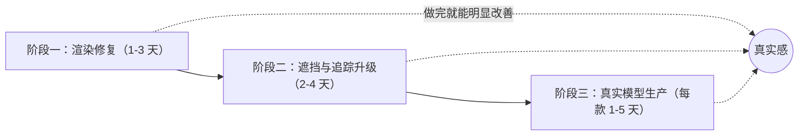

# AR 虚拟试戴真实感提升：实施指南

> 适用代码库：`Klarheit/front_end`（three `^0.184`、`@mediapipe/tasks-vision ^0.10.35`、React 19 + Vite 6）
> 目标：解决试戴界面里眼镜"假、塑料、和实物对不上"的问题
> 本文只给方案、步骤、参数和代码片段，不改动仓库代码

---

## 0. 结论与路线图

**不必等厂家 CAD。** 真实感由三部分决定，影响从大到小：

1. **合成**：眼镜和摄像头画面能不能融为一体（遮挡、投影、透光、光照匹配）。这是现在最主要的问题，改动在渲染层，不需要新模型。
2. **材质**：PBR 参数是否符合真实物理，倒角上有没有高光。
3. **几何**：形状和尺寸是否忠于实物。CAD 只解决这一项，而且 CAD 本身不带材质。



| 阶段 | 内容 | 需要新模型 | 预期效果 |
|---|---|---|---|
| 一 | GLB 遮挡和投影、视频放进场景、镜片材质、光照、画面融合 | 否 | ★★★★ |
| 二 | 用人脸网格做遮挡、更好的平滑滤波、帧同步 | 否 | ★★★ |
| 三 | 按实物建模，配真实 PBR 材质 | 是 | ★★★★ |

---

## 1. 现状诊断（根因清单）

### 1.1 几何：模型是代码拼出来的
[export-frame-glbs.mjs](file:///c:/Users/17761/Desktop/Klarheit/front_end/scripts/export-frame-glbs.mjs) 用 `ExtrudeGeometry`（平面轮廓拉伸）、`BoxGeometry`、`CylinderGeometry` 拼出 4 款镜框：
- 镜框正面完全是平的。真实镜框有**基弯**（base curve）、**面弯**（face form，左右向后包）和**前倾角**（pantoscopic tilt）。
- 圈的截面粗细到处一样。桥梁和鼻托是长方体（如 [L470](file:///c:/Users/17761/Desktop/Klarheit/front_end/scripts/export-frame-glbs.mjs#L470)、[L495](file:///c:/Users/17761/Desktop/Klarheit/front_end/scripts/export-frame-glbs.mjs#L495)）。
- 倒角很小，甚至没有。现实中没有绝对锐利的边，**边缘高光是让人觉得"像真的"的关键**。

### 1.2 合成：GLB 加载后遮挡和投影都丢了（Bug）
- 头部遮挡体（只写深度、不写颜色）和投影接收面只在 [`headOccluder`](file:///c:/Users/17761/Desktop/Klarheit/front_end/src/ar/glassesGeometry.ts#L260-L284) 里，由 [`createProceduralGlasses`](file:///c:/Users/17761/Desktop/Klarheit/front_end/src/ar/glassesGeometry.ts#L554-L574) 挂到**程序模型内部**。
- GLB 加载成功后 [ARTryOnCanvas.tsx L309-L321](file:///c:/Users/17761/Desktop/Klarheit/front_end/src/ar/ARTryOnCanvas.tsx#L309-L321) 会把整个程序模型移除，遮挡体和投影也跟着没了。GLB 里的网格也没有设 `castShadow`。
- 结果：镜腿画在脸颊和耳朵上面，脸上也没有镜框的影子，眼镜像一张"贴纸"。
- 另外，遮挡体能不能挡住镜腿，现在要看 three.js 的不透明物体排序碰不碰巧。镜腿如果先画，遮挡体后画就擦不掉了，所以必须显式设置 `renderOrder`。

### 1.3 合成：镜片发白，透不出画面
- 摄像头画面是放在透明 canvas 后面的 DOM `<video>`（[ARTryOnCanvas.tsx L486-L502](file:///c:/Users/17761/Desktop/Klarheit/front_end/src/ar/ARTryOnCanvas.tsx#L486-L502)），不在 3D 场景里。
- three r184 的透射 pass（`node_modules/three/src/renderers/WebGLRenderer.js` 里的 `renderTransmissionPass`）有这样一段：
  ```js
  if ( _currentClearAlpha < 1 ) _this.setClearColor( 0xffffff, 0.5 );
  _this.clear();
  if ( _renderBackground ) background.render( scene );
  ```
  我们的 renderer 是 `alpha: true`、clear alpha 为 0，所以透射纹理被清成**半透明白色**。镜片"透过去"看到的是一片白，这就是发白、发塑料的直接原因。
- 再加上镜片材质用了 `opacity 0.28`、蓝色 `sheen`（布料用的光泽）和青色 `emissive`（[frameTextures.ts L254-L274](file:///c:/Users/17761/Desktop/Klarheit/front_end/src/ar/frameTextures.ts#L254-L274)），真实镜片都不会有这些效果。

### 1.4 光照：与摄像头画面不一致
- 环境反射用的是 canvas 画的渐变假图（[`buildIndoorEnvTexture`](file:///c:/Users/17761/Desktop/Klarheit/front_end/src/ar/glassesGeometry.ts#L576-L653)）。
- `AmbientLight 0.72` 加 3 盏方向光，再加 `toneMappingExposure 1.18`（[ARTryOnCanvas.tsx L238-L280](file:///c:/Users/17761/Desktop/Klarheit/front_end/src/ar/ARTryOnCanvas.tsx#L238-L280)）：整体太亮太平。用户在暗房间里，眼镜仍然像在影棚里一样亮。

### 1.5 画面质感：CG 太"干净"
- canvas 按 `devicePixelRatio`（最高 2）渲染，摄像头通常只有 640×480 或 1280×720，所以眼镜比脸锐利得多。
- 摄像头画面有噪点、轻微模糊和压缩痕迹，眼镜上一点都没有。

### 1.6 材质覆盖逻辑会吃掉真实贴图
[`enhanceGlbMaterials`](file:///c:/Users/17761/Desktop/Klarheit/front_end/src/ar/enhanceGlbMaterials.ts#L16-L74) 按材质名**整体替换**为程序生成的材质。以后换成带真实贴图的 GLB，贴图会被直接丢掉。必须先改这里，再接入新模型（见 3.6）。

---

## 2. 坐标和单位约定（新模型必须遵守）

缩放公式在 [`calculateGlassesTransform3D`](file:///c:/Users/17761/Desktop/Klarheit/front_end/src/ar/ARTryOnCanvas.tsx#L155-L156)：

```
scaleVal = eyeDistWorld * (lensCenterDistanceMm / (userPdMm * 0.48))
```

它隐含了一个约定：**模型里两镜片中心的距离 = 0.48 个单位**（现有模型的 `LENS_X = 0.24`）。`lensCenterDistanceMm = 镜片宽 A + 鼻梁宽 DBL`，由 [`getFrameConfigForProduct`](file:///c:/Users/17761/Desktop/Klarheit/front_end/src/ar/frameCatalog.ts#L154-L199) 从规格（如 `54-17-140`）算出。

| 项 | 约定 |
|---|---|
| 朝向 | +Y 向上，+Z 指向摄像头（镜框正面朝 +Z），镜腿沿 −Z 往后 |
| 原点 X | 两镜片几何中心的中点 |
| 原点 Y | 镜片水平中线（方框法的几何中心高度） |
| 原点 Z | 镜框前片背面（贴近鼻托的那一面）≈ 0 |
| 镜片中心 | `x = ±0.24`（归一化单位） |
| 镜腿 | 张开角度按真实佩戴状态，不要折叠 |

**新模型推荐用"真实米制 + 运行时归一化"**：
- Blender 里按真实毫米建模，导出的 glTF 是米制（54mm → 0.054）。
- 加载后套一层缩放：`normalize = 0.48 / (lensCenterDistanceMm / 1000)`。
- 在 [`ARFrameConfig`](file:///c:/Users/17761/Desktop/Klarheit/front_end/src/ar/types.ts) 里加一个字段 `modelScaleMode: "normalized" | "real-meters"`，用来区分旧的程序 GLB 和新的真实 GLB：

```ts
// 伪代码：GLB 加载回调里
const wrapper = new THREE.Group();
wrapper.add(gltf.scene);
if (frame.modelScaleMode === "real-meters") {
  const s = 0.48 / ((frame.lensCenterDistanceMm ?? 71) / 1000);
  wrapper.scale.setScalar(s);
}
activeModel = wrapper;
```

> [!IMPORTANT]
> 材质的 `thickness`、`attenuationDistance` 是在**网格本地空间**里计算的，会跟着缩放变化。真实米制模型里镜片厚 2mm 就填 `0.002`，归一化以后自动正确，不要按归一化单位去填。

---

## 3. 阶段一：渲染修复（不需要新模型）

建议按顺序做，每做完一步就截图和上一步对比。

### 3.1 遮挡体和投影接收面挂到 `glassesGroup`，不跟着模型走

**改动位置**：[glassesGeometry.ts](file:///c:/Users/17761/Desktop/Klarheit/front_end/src/ar/glassesGeometry.ts)、[ARTryOnCanvas.tsx](file:///c:/Users/17761/Desktop/Klarheit/front_end/src/ar/ARTryOnCanvas.tsx)

步骤：
1. 把 `headOccluder` 拆成两部分：
   - `createHeadOccluder(): THREE.Group`：只负责创建遮挡体和投影接收面，不再遍历模型。
   - `prepareModelForShadows(model)`：遍历模型，给非辅助网格设 `castShadow = true`。
2. `createProceduralGlasses` 不再调用遮挡逻辑。
3. 在 `ARTryOnCanvas` 初始化时，把遮挡组 `glassesGroup.add(...)` 一次，和模型同级、永远保留。
4. 程序模型创建后、GLB 加载后，都调用 `prepareModelForShadows(activeModel)`。
5. **显式设置渲染顺序**：
   ```ts
   occluderMesh.renderOrder = -1;   // 先写深度
   occluderMesh.material.depthWrite = true;
   occluderMesh.material.colorWrite = false;
   shadowCatcher.renderOrder = 1;   // 透明 pass，排在后面
   ```
   原理：three.js 先按 `renderOrder` 排序，再按距离排序。遮挡体必须在任何镜框网格之前写入深度。
6. 投影浓一些、软一些：`ShadowMaterial({ opacity: 0.28 })`（现在是 0.15，太淡）。`keyLight.shadow.radius` 设 4~6，或者改用 `THREE.VSMShadowMap`（要同时设 `shadow.blurSamples`）。

**验收**：转头 30° 时，远侧镜腿被脸颊和耳前挡住；镜框下方的颧骨和鼻梁上能看到淡淡的影子。

### 3.2 摄像头画面放进 3D 场景（修好镜片发白，为后面几步打基础）

**改动位置**：[ARTryOnCanvas.tsx](file:///c:/Users/17761/Desktop/Klarheit/front_end/src/ar/ARTryOnCanvas.tsx)、[`captureCompositeFrame`](file:///c:/Users/17761/Desktop/Klarheit/front_end/src/ar/glassesGeometry.ts#L655-L703)

步骤：
1. 创建视频纹理，设为场景背景：
   ```ts
   const videoTex = new THREE.VideoTexture(videoEl);
   videoTex.colorSpace = THREE.SRGBColorSpace; // 背景就不会被 ACES 色调映射
   videoTex.minFilter = THREE.LinearFilter;
   videoTex.generateMipmaps = false;
   scene.background = videoTex;
   ```
   - 背景会自动画进透射 pass（见 1.3 源码），镜片就能透出、折射真实画面。
   - 背景永远最先画，遮挡体只写深度，不会在画面上"打洞"。
2. **模拟 `object-cover` 裁切**。要和 [`toViewportPoint`](file:///c:/Users/17761/Desktop/Klarheit/front_end/src/ar/ARTryOnCanvas.tsx#L49-L63) 的逻辑完全一致，否则眼镜会偏：
   ```ts
   function applyCover(tex, videoAspect, viewAspect) {
     tex.matrixAutoUpdate = true;
     if (videoAspect > viewAspect) {        // 视频更宽：裁左右
       tex.repeat.set(viewAspect / videoAspect, 1);
       tex.offset.set((1 - tex.repeat.x) / 2, 0);
     } else {                                // 视频更高：裁上下
       tex.repeat.set(1, videoAspect / viewAspect);
       tex.offset.set(0, (1 - tex.repeat.y) / 2);
     }
   }
   ```
   在 `resize()` 和 `video.onloadedmetadata` 里都要调用。
3. **镜像**：canvas 本身已经有 CSS `scale-x-[-1]`，视频纹理**不要**再镜像，整张 canvas 会一起翻转，保持一致。
4. **隐藏 DOM `<video>`，但不要 `display:none`**（iOS Safari 可能会停止解码）。用 `opacity-0 pointer-events-none`，或者 1px 大小加绝对定位。
5. renderer 可以改成 `alpha: false`；保留 `alpha: true` 就设 `setClearColor(0x000000, 1)`。
6. **截图**：画面已经都在 canvas 里了，`captureCompositeFrame` 删掉"先画 video"那一步，只画 canvas（保留水平镜像和水印）。`preserveDrawingBuffer: true` 继续保留。
7. 性能：透射 pass 大约让渲染成本翻倍。移动端设 `renderer.transmissionResolutionScale = 0.5`（r184 已支持）。

**验收**：镜片背后的眼睛和皮肤清晰可见；镜片边缘有轻微折射错位；镜片不再发白、发灰。

### 3.3 重做镜片和镜框材质（物理参数）

**改动位置**：[frameTextures.ts `buildEnhancedMaterials`](file:///c:/Users/17761/Desktop/Klarheit/front_end/src/ar/frameTextures.ts#L206-L331)，以及 [glassesGeometry.ts](file:///c:/Users/17761/Desktop/Klarheit/front_end/src/ar/glassesGeometry.ts#L108-L240) 里对应的程序材质（两处保持一致）

**核心原则**：
- 透明物体用 `transmission` 表现，**不要再叠 `opacity`**。
- 去掉 `sheen` 和 `emissive`。
- 镀膜反光用 `iridescence`（薄膜干涉），这才是 AR 镀膜的物理本质。

| 材质 | 关键参数（`MeshPhysicalMaterial`） |
|---|---|
| **光学镜片**（CR-39 / 1.60 / 1.67） | `color #ffffff`、`metalness 0`、`roughness 0`、`transmission 1`、`transparent false`、`ior 1.50 / 1.60 / 1.67`、`thickness 0.002`（米制）、`specularIntensity 1`、`iridescence 1`、`iridescenceIOR 1.35`、`iridescenceThicknessRange [250, 420]`、`envMapIntensity 1` |
| **墨镜片** | `transmission 1`、`roughness 0`、`ior 1.5`、`thickness 0.002`、`attenuationColor` 用镜片色（灰 `#3a3f44` / 茶 `#5a3b22` / G15 绿 `#3c4a36`）、`attenuationDistance 0.0015~0.003`（越小越深）；水银镜面再加 `iridescence 1`、`iridescenceThicknessRange [400, 800]` |
| **钛 / 不锈钢（拉丝）** | `metalness 1`、`roughness 0.28~0.4`、`color`：钛 `#c1bab1`、钢 `#c4c6c8`、`anisotropy 0.6~0.8`、`anisotropyRotation` 沿镜圈方向（要正确的 UV 或切线）；电镀亮面才加 `clearcoat 0.3` |
| **黄金 / 玫瑰金电镀** | `metalness 1`、`roughness 0.18~0.3`、`color`：金 `#ffe29b`、玫瑰金 `#f1c3ae` |
| **亮面板材（acetate）** | `metalness 0`、`roughness 0.12~0.2`、`ior 1.49`、`clearcoat 1`、`clearcoatRoughness 0.03~0.06` |
| **哑光黑板材** | `metalness 0`、`roughness 0.45~0.6`、`clearcoat 0` |
| **玳瑁板材** | `map`（真实玳瑁贴图）、`roughness 0.15`、`clearcoat 1`、`transmission 0.35`、`thickness 0.004`、`attenuationColor #8a4b1a`、`attenuationDistance 0.003` |
| **透明水晶板材** | `transmission 1`、`roughness 0.03`、`ior 1.49`、`thickness 0.004`、`attenuationColor #e9f1f3`、`attenuationDistance 0.02`、`clearcoat 1` |
| **硅胶鼻托** | `transmission 0.6`、`roughness 0.35`、`ior 1.41`、`thickness 0.003` |

补充：
- 现在拉丝金属的 `normalMap` 用 `Math.sin` 条纹生成，会出现规律重复的摩尔纹。有了 `anisotropy` 后直接**删掉这张法线贴图**，或者换成真实的拉丝扫描贴图。
- 用归一化旧模型调试时，`thickness`、`attenuationDistance` 要按 1 单位 ≈ `(A+DBL)/0.48` mm 换算（AERO X1：1 单位 ≈ 148 mm，2 mm ≈ 0.0135）。

### 3.4 环境反射和灯光

**改动位置**：[ARTryOnCanvas.tsx L246-L280](file:///c:/Users/17761/Desktop/Klarheit/front_end/src/ar/ARTryOnCanvas.tsx#L246-L280)

**第 1 步：换掉假环境图（必做）**
- 简单方案：`import { RoomEnvironment } from "three/examples/jsm/environments/RoomEnvironment.js"`，然后 `pmrem.fromScene(new RoomEnvironment(), 0.04)`。
- 更好的方案：从 Poly Haven 下载一张 1K 室内或影棚 HDRI（推荐 `studio_small_08`、`photo_studio_loft_hall` 等），放到 `public/env/`，用 `three/examples/jsm/loaders/HDRLoader.js` 加载（r184 里 `RGBELoader` 已改名为 `HDRLoader`），再用 PMREM 处理。
- `scene.environmentIntensity` 设 0.8~1.0。

**第 2 步：降低补光**
- `AmbientLight` 降到 0.15~0.25（主要依赖环境图提供漫反射）。
- `toneMappingExposure` 从 1.18 改为 1.0，交给第 3 步动态调整。
- key light 保留并投影；fill 和 rim 降到 0.3 左右。

**第 3 步：从摄像头画面估算光照（性价比最高的一步）**

每 200ms 做一次（不要每帧做）：
1. 把视频画到 64×48 的离屏 canvas 上，`getImageData`。
2. 用人脸关键点框出**额头**（10、151 附近）、**左脸颊**（50 / 205 附近）、**右脸颊**（280 / 425 附近）三块区域，分别求平均 RGB，先转成线性空间再算亮度 `Y = 0.2126R + 0.7152G + 0.0722B`。
3. 曝光：`exposure = clamp(Y_face / Y_ref, 0.55, 1.4)`，`Y_ref` 取正常室内的经验值（约 0.35），实测后再调。
4. 色温：用额头平均颜色归一化（`rgb / max(rgb)`），和白色按 50% 混合，作为 `keyLight.color` 和 `ambient.color`。暖光房间里，眼镜也会偏暖。
5. 主光方向：`dir = (Y_right - Y_left) / (Y_right + Y_left)`，`keyLight.position.x = dir * 3`（注意画面是镜像的，左右要实测确认）。
6. 所有数值做 EMA 平滑（系数 0.1），避免闪烁。

**第 4 步（可选）：用视频生成环境反射**
- 每 500ms 把视频画进 256×128 的 canvas：左右镜像拼成 2:1，`ctx.filter = "blur(6px)"`，再 `pmrem.fromEquirectangular()`，替换 `scene.environment`，同时 `dispose()` 旧的 render target。
- 和 HDRI 二选一或混合使用：HDRI 提供干净高光，视频环境提供真实颜色。金属镜框受益最大。

### 3.5 画面融合（让 CG 带上摄像头质感）

1. **分辨率匹配**（简单且有效）：
   ```ts
   const visibleVideoH = coverCroppedVideoHeight;          // 裁切后可见的视频像素高
   const pr = Math.min(window.devicePixelRatio, Math.max(1, visibleVideoH / cssHeight));
   renderer.setPixelRatio(pr);
   ```
   眼镜和人脸的清晰度基本一致。
2. **噪点（可选）**：用 `EffectComposer` + `RenderPass` + `FilmPass(0.15~0.25)` + `OutputPass`（OutputPass 负责色调映射和色彩空间，**必须放在最后**）。代价是多一次全屏 pass。
3. **轻微模糊（可选）**：自定义 ShaderPass，只对眼镜做 0.5px 高斯模糊。可以把眼镜 alpha 渲染到单独的 render target 当遮罩。先做第 1 条，不够再考虑。
4. **运动平滑**：现在用固定 0.38 的 EMA（[L444-L449](file:///c:/Users/17761/Desktop/Klarheit/front_end/src/ar/ARTryOnCanvas.tsx#L444-L449)），静止时会抖，快速转头时会拖。换成 **One Euro Filter**，对位置、四元数（用 slerp 形式）和缩放分别滤波。推荐参数 `minCutoff 1.0`、`beta 0.02~0.05`、`dCutoff 1.0`。眼镜抖动是"假"感的重要来源。

### 3.6 让 `enhanceGlbMaterials` 尊重模型自带的材质

**改动位置**：[enhanceGlbMaterials.ts](file:///c:/Users/17761/Desktop/Klarheit/front_end/src/ar/enhanceGlbMaterials.ts#L25-L73)

规则：
- 材质已经有 `map`、`normalMap`、`roughnessMap`，或者 `transmission > 0`，说明美术已经做好了，**跳过不替换**。
- 或者约定：材质名以 `pbr-` 开头时一律跳过；也可以在 GLB 的 `extras` 里写 `{ "keepMaterial": true }`，GLTFLoader 会放进 `material.userData`。
- 旧的程序 GLB 继续走替换逻辑。

---

## 4. 阶段二：遮挡和追踪升级

### 4.1 用人脸网格做遮挡（替换或补充椭球）
椭球和真实脸型差别很大：鼻梁两侧、颧骨、太阳穴都对不上，鼻托和镜腿会穿模或者被错误遮挡。

步骤：
1. 获取三角面索引：MediaPipe 仓库 `mediapipe/modules/face_geometry/data/canonical_face_model.obj`（468 个顶点，约 898 个三角面）。离线解析 `f` 行，生成 `faceTriangles.json`（注意 OBJ 索引从 1 开始，要减 1）。
   > `FaceLandmarker.FACE_LANDMARKS_TESSELATION` 是**边**列表，不是三角面，不能直接拿来当 index。
2. 建一个 `BufferGeometry`：position 有 468×3 个浮点（不用虹膜的 10 个点），用上面的 index。材质是 `MeshBasicMaterial({ colorWrite: false })`，`renderOrder = -1`。
3. 这个网格放在**场景根节点**（世界坐标），不要放进 `glassesGroup`。
4. 每帧用和 [`calculateGlassesTransform3D`](file:///c:/Users/17761/Desktop/Klarheit/front_end/src/ar/ARTryOnCanvas.tsx#L106-L145) **完全一样**的映射（`toViewportPoint` → frustum → `Z_face - z * scaleZ`）把每个关键点写进 position，然后 `needsUpdate = true`、`computeVertexNormals()`。
5. 沿法线往里收 1~2mm（按世界单位换算），避免鼻托被"吃掉"。
6. 复制一份同样的几何体，配 `ShadowMaterial` 作为投影接收面：影子会准确落在鼻梁和颧骨上。
7. 人脸网格不包括耳朵和侧脑，所以**仍然保留一个侧头胶囊体**来挡镜腿后段。宽度用关键点 234 / 454（脸两侧靠近耳前的位置）的世界距离 × 1.05，高度和深度按经验比例设置。

### 4.2 （可选）使用 MediaPipe 的面部变换矩阵
- [faceLandmarker.ts](file:///c:/Users/17761/Desktop/Klarheit/front_end/src/ar/faceLandmarker.ts) 的配置里加 `outputFacialTransformationMatrixes: true`，结果里会有 `facialTransformationMatrixes[0].data`（4×4 列主序，单位 cm，标准人脸坐标系）。
- 优点是位姿（尤其是深度和俯仰）比现在用 4 个点手算的更稳。缺点是要让 three 相机的 FOV 和 MediaPipe 假设的相机一致，改动面大。`FaceLandmarkerDetector` 接口类型也要扩展。
- 建议 4.1 和 3.5 第 4 条都做完、效果还不满意时再做。

### 4.3 （可选）视频帧和位姿同步
用 `video.requestVideoFrameCallback` 驱动检测：哪一帧算出关键点，就把那一帧画进 `VideoTexture`（`videoTex.needsUpdate` 改成手动控制），眼镜和画面就严格同帧，快速转头时不会"漂"。这一步只有在 3.2 完成之后才能做。

---

## 5. 阶段三：真实模型生产

### 5.1 模型来源对比

| 方式 | 几何精度 | 材质 | 成本和周期 | 适用场景 |
|---|---|---|---|---|
| 厂家 CAD（STEP/IGES） | 最高 | 没有，要另做 | 看厂家；转换加材质约 1~2 天/款 | 厂家配合的核心款 |
| **建模师按实物建模（推荐）** | 高（±0.3mm） | 同时做 PBR | 约 500~1500 元/款，1~3 天 | 绝大多数情况 |
| 3D 扫描 / 摄影测量 | 中 | 只能参考 | 要喷显影剂；镜片要手动补 | 造型复杂的板材款 |
| AI 图生 3D（Tripo / Meshy / Hunyuan3D / Rodin） | 低到中 | 不可用 | 很便宜，几分钟 | 只当建模底稿 |

> [!TIP]
> 拿到 CAD 时：STEP 先在 FreeCAD / Fusion / Rhino 里按 0.05mm 弦差导出成 OBJ 或 FBX，再到 Blender 里重新拓扑、展 UV、做材质。CAD 曲面直接三角化通常有几十万面，法线也有问题，不能直接上 Web。

### 5.2 测量清单（每款实物都要量）

工具：游标卡尺、基弯测量表（lens clock，没有就拍侧面照估算）、量角器、方格纸。

| 测量项 | 说明 |
|---|---|
| A 镜片宽、B 镜片高、DBL 鼻梁宽 | 方框法；镜腿内侧通常印着 `A□DBL-镜腿长` |
| 镜框总宽 | 两侧铰链外缘之间 |
| 镜腿长度、弯点长度 | 从铰链到耳弯、耳弯到末端 |
| 基弯 | 曲率半径 R(mm) ≈ 523 / 基弯数：4 基弯 ≈ 131mm，6 基弯 ≈ 87mm，8 基弯 ≈ 65mm |
| 面弯角 | 光学架一般 3°~7°，运动墨镜 10°~20° |
| 前倾角 | 一般 8°~12° |
| 圈截面 | 正面宽、侧面深（板材常见 4~7mm 深，金属 1~2mm） |
| 镜腿截面 | 宽和厚，从铰链到末端的变化 |
| 鼻托 | 位置、角度、大小 |
| 颜色和光泽 | 在 D65 灯箱或白天阴天窗边，和色卡一起拍 |

参考照片：85mm 以上焦距、远距离拍摄（减少透视变形），拍正面、侧面、顶面、45° 四个角度，镜框和直尺放在同一平面。

### 5.3 Blender 建模流程

1. **场景设置**：`Scene > Units`：Metric，`Unit Scale 0.001`，`Length: Millimeters`。按第 2 节的约定放原点和朝向（Blender 里是 Z 向上，导出时勾选 `+Y Up` 自动转换）。
2. **参考图**：`Add > Image > Reference` 导入正面和侧面照片，按实测 A 缩放对齐。
3. **镜片轮廓**：贝塞尔曲线描正面照片里的镜片形状，转成网格，作为 `Lens_L` 的基础；镜像得到 `Lens_R`。
4. **镜圈**：轮廓内外各偏移（Inset），加 Solidify 得到截面深度。用 **Simple Deform（Bend）** 或 Lattice 弯成基弯的球面。
5. **面弯和前倾**：左右镜圈绕各自内侧竖轴向后转 3°~7°；整个前片绕 X 轴转出前倾角。
6. **倒角（关键）**：所有边加 Bevel，金属 0.15~0.3mm，板材 0.4~0.8mm，`Segments 3`，`Harden Normals` 打开，再加 Weighted Normal 修改器。
7. **桥梁、桩头、铰链、螺丝**：按实测做。铰链的原点放在转轴上，方便以后做开合动画。
8. **镜腿**：按真实张开角度（前片和镜腿约 95°~100°）建模；耳弯处向下弯 15°~25°。
9. **鼻托**：单独的网格，硅胶材质。
10. **镜片**：独立网格，前后表面是不同曲率的球面，中心厚约 1.8~2.2mm，边缘按度数适当加厚。和镜圈槽之间留 0.05mm 间隙，避免 z-fighting。
11. **面数预算**：整副 15k~50k 三角面，镜片每片 ≤ 2k。Subdivision 应用之后再 Decimate 到预算内。
12. **UV**：玳瑁、拉丝金属这类有方向性纹理的部件必须认真展 UV。拉丝方向沿 U 轴，方便 `anisotropyRotation` 生效。

### 5.4 材质和贴图

- 按 3.3 的参数表，用 Principled BSDF 设置（Blender 4.x 的 Principled BSDF 能导出 transmission、ior、clearcoat（Coat）、specular、sheen、anisotropy、volume 等 glTF 扩展）。导不出来的参数在运行时按材质名补上。
- **材质命名**（兼容 [`enhanceGlbMaterials`](file:///c:/Users/17761/Desktop/Klarheit/front_end/src/ar/enhanceGlbMaterials.ts) 的匹配规则）：`titanium`、`steel`、`gold`、`acetate-black`、`tortoise`、`crystal`、`optical-lens`、`sun-lens`、`silicone`。自带贴图、不希望被替换的，加前缀 `pbr-`（配合 3.6）。
- **网格命名**：`Frame_Front`、`Bridge`、`Hinge_L/R`、`Temple_L/R`、`Tip_L/R`、`Lens_L/R`、`Pad_L/R`。
- **贴图**：BaseColor（sRGB）、ORM（AO/Roughness/Metallic 打包，线性）、Normal（线性），1024~2048。
- **玳瑁和花色板材**：用正交偏振光拍真实板材（去掉反光），做成无缝贴图；或者购买高质量扫描纹理。
- **多色版本**：一个 GLB，主色材质命名为 `frame-primary`，运行时换 `color` 或贴图。不要每个颜色导一个 GLB。[`getFrameConfigForProduct`](file:///c:/Users/17761/Desktop/Klarheit/front_end/src/ar/frameCatalog.ts#L176-L180) 现在只给默认款挂 GLB，要相应修改。

### 5.5 导出和压缩

Blender `File > Export > glTF 2.0`：
- Format：**glTF Binary (.glb)**
- Include：Selected Objects
- Transform：**+Y Up** ✔
- Mesh：Apply Modifiers ✔、UVs ✔、Normals ✔、Tangents ✔（anisotropy 需要）
- Material：Export
- Compression：先不勾，下一步统一处理

压缩（Node 环境）：
```bash
npx @gltf-transform/cli optimize in.glb out.glb --compress meshopt --texture-compress webp --texture-size 2048
```
目标：**每款 ≤ 1.5 MB**。

加载端（`ARTryOnCanvas` 里的 GLTFLoader）：
```ts
import { MeshoptDecoder } from "three/examples/jsm/libs/meshopt_decoder.module.js";
gltfLoader.setMeshoptDecoder(MeshoptDecoder);
// 如果改用 KTX2 贴图，还要 setKTX2Loader(new KTX2Loader().setTranscoderPath(...).detectSupport(renderer))
```

接入：
1. 文件放到 `public/models/frames/`，更新 [`FRAME_MODEL_URLS`](file:///c:/Users/17761/Desktop/Klarheit/front_end/src/ar/frameCatalog.ts#L111-L116)。
2. 配置 `modelScaleMode: "real-meters"`（第 2 节）。
3. 用 `transformOffset` 微调佩戴高度。一般镜片中心在瞳孔上方 0~3mm，`position[1]` 在 −0.02 ~ −0.035 之间。
4. 确认 [`PRODUCT_SPECS`](file:///c:/Users/17761/Desktop/Klarheit/front_end/src/ar/frameCatalog.ts#L100-L108) 或后端 `specsSize` 和实测的 A/DBL 一致，否则缩放会错。

---

## 6. 验收标准

### 6.1 视觉对照测试（最重要）
真人戴上实物眼镜，在同一位置、同一光线下用同一摄像头拍照；再摘掉，用 AR 试戴拍同一角度。并排对比：

- [ ] 尺寸：镜框总宽、镜片和眼睛的相对位置误差 < 3mm
- [ ] 遮挡：侧脸 30°~45° 时远侧镜腿被正确遮挡；镜腿在耳前消失
- [ ] 投影：鼻梁和颧骨上有柔和的影子
- [ ] 镜片：透出眼睛，清楚不发白；斜看有淡绿或淡紫的镀膜反光
- [ ] 边缘：镜框边缘有细高光线（倒角生效）
- [ ] 光照：暗房间里眼镜跟着变暗；暖光下眼镜偏暖
- [ ] 清晰度：眼镜和脸的锐度接近
- [ ] 稳定性：静止时不抖，快速转头时跟随延迟 < 2 帧

### 6.2 性能预算
| 设备 | 目标 |
|---|---|
| 中端安卓（如骁龙 7 系） | ≥ 30 FPS |
| iPhone 12 及以上 | ≥ 50 FPS |
| 桌面集显 | ≥ 60 FPS |

不达标时依次降级：`transmissionResolutionScale 0.5` → 阴影贴图 512 → 关闭 FilmPass → 视频环境反射改成 1000ms 更新一次。

### 6.3 回归测试
- [ARTryOnCanvas.test.tsx](file:///c:/Users/17761/Desktop/Klarheit/front_end/src/ar/ARTryOnCanvas.test.tsx) 是在 jsdom 下运行的，没有 WebGL 和 `VideoTexture`。新增逻辑要做 `try/catch` 降级，参考 `enhanceGlbMaterials` 现在的写法。
- [arCalibration.test.ts](file:///c:/Users/17761/Desktop/Klarheit/front_end/src/ar/arCalibration.test.ts)：确认缩放公式没有被改坏。
- 截图功能：确认截出来的图里视频和眼镜都在、没有重复叠加、水印正常。

---

## 7. 常见问题

| 现象 | 原因 | 处理 |
|---|---|---|
| 镜片发白或发灰 | 透射 pass 被清成半透明白色（1.3） | 视频进场景当背景（3.2） |
| 视频颜色变淡、发灰 | 背景纹理被色调映射了 | `videoTex.colorSpace = SRGBColorSpace` |
| 遮挡偶尔失效 | 渲染顺序不确定 | 遮挡体 `renderOrder = -1` |
| 眼镜和脸对不齐 | 背景裁切和 `toViewportPoint` 不一致 | 按 3.2 第 2 条实现 cover |
| 镜片厚度或颜色明显不对 | `thickness` 单位填错 | 按第 2 节的本地单位填 |
| 新 GLB 贴图丢了 | `enhanceGlbMaterials` 覆盖了材质 | 3.6 |
| GLB 加载失败但没有任何提示 | [L324-L326](file:///c:/Users/17761/Desktop/Klarheit/front_end/src/ar/ARTryOnCanvas.tsx#L324-L326) 静默回退到程序模型 | 开发环境里 `console.warn` 输出错误 |
| Meshopt 模型加载报错 | 没有设置解码器 | `setMeshoptDecoder` |
| iOS 上画面黑屏 | DOM video 被 `display:none` | 改用 opacity 0 |
| 镜腿在耳朵处穿模 | 只有人脸网格，没有侧头遮挡 | 4.1 第 7 条 |

---

## 8. 推荐执行顺序（检查清单）

- [ ] 3.1 遮挡体挂到 `glassesGroup`，设置 `renderOrder`，GLB 开启投影
- [ ] 3.2 视频进场景，实现 cover 裁切，修改截图逻辑
- [ ] 3.3 镜片改为 transmission + iridescence，去掉 sheen 和 emissive
- [ ] 3.4 换 HDRI 或 RoomEnvironment，降低环境光，加光照估算
- [ ] 3.5 分辨率匹配，One Euro 平滑
- [ ] 3.6 `enhanceGlbMaterials` 跳过 PBR 材质
- [ ] **第一次对照测试**（6.1）
- [ ] 4.1 人脸网格遮挡 + 侧头胶囊体
- [ ] 5.x 先用一款（推荐 MONOLITH 02，板材款最容易出效果）走完实物建模全流程
- [ ] **第二次对照测试**，确认流程后再批量做其余款式
