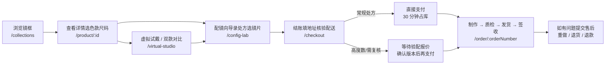
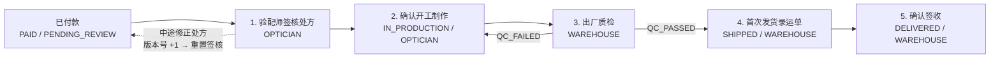

# Klarheit 光学定制平台操作指南（普通用户 & 管理员/运营岗位）

> 适用版本：Klarheit 生产就绪版（对应后端 `V26` / 前端当前版本）。  
> 业务时区统一为 **`Asia/Shanghai`（北京时间）**，结算币种为 **人民币（CNY）**，当前配送范围为**中国大陆**。

---

## 目录

- [第一部分：普通用户操作指南](#第一部分普通用户操作指南)
  - [1. 账号注册、登录与密码找回](#1-账号注册登录与密码找回)
  - [2. 挑选镜框与规格（商品系列 & 详情页）](#2-挑选镜框与规格商品系列--详情页)
  - [3. 虚拟试戴与双款对比（AR 试戴室）](#3-虚拟试戴与双款对比ar-试戴室)
  - [4. 配镜向导与购物车](#4-配镜向导与购物车)
  - [5. 结账下单与付款前验配复核](#5-结账下单与付款前验配复核)
  - [6. 订单追踪、履约进度与确认报价](#6-订单追踪履约进度与确认报价)
  - [7. 售后申请、退货、免费重做与退款查看](#7-售后申请退货免费重做与退款查看)
  - [8. 个人账户、处方档案、地址簿与隐私权利](#8-个人账户处方档案地址簿与隐私权利)
- [第二部分：管理员与运营各岗位操作指南](#第二部分管理员与运营各岗位操作指南)
  - [1. 后台入口与五大岗位权限矩阵](#1-后台入口与五大岗位权限矩阵)
  - [2. 实时运维告警条与日常巡检](#2-实时运维告警条与日常巡检)
  - [3. 订单履约全流程（SOP 与硬门禁）](#3-订单履约全流程sop-与硬门禁)
  - [4. 付款前验配复核与多版本报价操作](#4-付款前验配复核与多版本报价操作)
  - [5. 发货前改址、首次发货、更正运单与确认签收](#5-发货前改址首次发货更正运单与确认签收)
  - [6. 商品目录、SKU 库存管理与仓库实盘核验](#6-商品目录sku-库存管理与仓库实盘核验)
  - [7. 售后工单处理：退件签收回库、重做、退款与财务核平](#7-售后工单处理退件签收回库重做退款与财务核平)
  - [8. 邮件通知队列与失败邮件幂等重发](#8-邮件通知队列与失败邮件幂等重发)
  - [9. 经营统计、分时段日对账 CSV 与应急停单开关](#9-经营统计分时段日对账-csv-与应急停单开关)
  - [10. 员工账号授权、离职撤权与审计日志](#10-员工账号授权离职撤权与审计日志)
- [第三部分：常见问题快速排查（FAQ）](#第三部分常见问题快速排查faq)

---

# 第一部分：普通用户操作指南

## 1. 账号注册、登录与密码找回

- **注册与登录**：点击顶部导航栏「**登录**」或「**打开账户**」，弹出右侧身份验证抽屉（支持键盘 `Tab` 焦点循环与 `Esc` 关闭）。
  - **注册**：切换至「注册」标签，填写名、姓、电子邮箱及不少于 8 位的密码。
  - **登录**：输入邮箱和密码完成登录；系统自动恢复您之前的配镜草稿或跳转回需要登录的页面。
- **忘记密码**：在登录抽屉点击「忘记密码？」，输入已绑定的手机号获取短信验证码，校验通过后设置新密码。
- **中英文切换**：点击顶部导航栏语言按钮，全站即时在中文与英文间切换。
- **公用设备安全提示**：请在使用完毕后点击「**退出登录**」，系统会自动清理当前浏览器中的本地登录态、处方草稿与试戴截图，防止与他人串号。

## 2. 挑选镜框与规格（商品系列 & 详情页）

- **筛选浏览（`/collections`）**：按镜框形状、材质、关键词快速检索，筛选条件会自动保存在网址中，分享链接或刷新页面均可保留。
- **选择色款与尺码（`/product/:id`）**：
  - 点击不同**色款（Finish）**与**尺码规格（Size Spec，如 `52-18-145`）**，页面实时显示该规格是否**有货 / 库存紧张 / 缺货（含预计补货日）/ 暂停销售**。
  - 缺货或暂停的色款/尺码会显示提示并禁止误下单，您仍可切换到其他有货规格继续购买或先进入 AR 预览。
  - 左侧支持在「商品实拍图」与「3D 模型预览」间切换查看镜框细节。
  - **无需登录即可查看售前支持**：商品详情页及全站页脚均提供售前客服与服务规则入口。

## 3. 虚拟试戴与双款对比（AR 试戴室）

进入路径：顶部导航栏「**虚拟试戴**」或商品详情页点击「**AR 试戴**」（`/virtual-studio`）。

1. **默认不自动开启摄像头**：进入页面后先展示 3D 模型/静态预览，仅当您主动点击「**开启摄像头试戴**」并授权后才调用本地摄像头。
2. **隐私保护**：人脸识别与镜框贴合完全在浏览器本地完成，**视频流不会上传至服务器**；离开页面或切换标签页后摄像头会立即关闭。
3. **试戴操作**：
   - 可随时切换不同款式与色款，并使用位置/缩放微调面板校准佩戴效果；
   - 支持点击「**双款对比**」同时选择 A/B 两款快速切换，点击「**加入购物车**」或「**选当前这副去配镜**」会精确带入当前正在查看的那一款（包括 B 款）的色款与尺码；
   - 可拍摄试戴截图并下载留存。
4. **弱网 / 无摄像头降级**：
   - 若设备无摄像头或您拒绝了相机权限，可直接使用 **3D 模型预览** 或 **静态商品图**；
   - 若在弱网环境下摄像头或识别模型超过 **6 秒** 未完成初始化，页面会自动弹出提示条，支持**一键切换至静态商品图**。

## 4. 配镜向导与购物车

### 配镜向导（`/config-lab`，需登录）
1. **确认镜框与规格**：默认承接您刚选中的镜框、色款与尺码。若所选规格临时缺货或下架，系统会明确提示并**保留您已填的处方**，请手动挑选替代款（不会静默替您换货）。
2. **填写验光处方**（也可从个人处方档案一键带入）：
   - 右眼/左眼球镜 `SPH`：`-20.00` 至 `+20.00`（步进 `0.25`）
   - 右眼/左眼柱镜 `CYL`：`-10.00` 至 `+10.00`（步进 `0.25`）
   - 右眼/左眼轴位 `AXIS`：`0` 至 `180`（整数）
   - 瞳距 `PD`：`40` 至 `80` mm（步进 `0.5`）
   - 若为家人代配，可填写「**佩戴人姓名**」并选择是否将该处方保存到个人档案。
3. **选择镜片与镀膜**：必须选择 **1 项基础折射率镜片**（如 1.56 / 1.61 / 1.67 / 1.74），并可按需叠加防蓝光、变色等功能镀膜。
4. 点击「**前往结账**」或「**加入购物车**」。

### 购物车（`/cart`）
- 购物车按镜框 + 色款 + 尺码 + 镜片组合展示，随时可修改数量、删除或「去结账」。
- 注意：普通选品保存在本地，但处方与试戴截图仅按登录账号临时保存，不会写入共享持久化存储。

## 5. 结账下单与付款前验配复核

进入路径：`/checkout`（需登录）。

1. **填写收货人信息**：可一键选用已保存的地址，或填写结构化省、市、区、详细地址与联系电话。
   - **实时配送校验**：系统会自动判断配送区域并显示预计送达时间与运费：
     - 中国大陆常规省市：**包邮，预计 10–14 个自然日**；
     - 新疆 / 西藏 / 青海：**偏远运费 ¥25，预计 14–18 个自然日**；
     - 港澳台及海外：暂不支持配送，页面会提示拦截；
     - 自由文本无法自动识别省市时，会提示需先进入人工复核再付款。
2. **核对处方与优惠码**：确认双眼度数、PD、镜片与优惠码折扣；若商品价格在您停留期间发生变动，需勾选「确认最新价格」后方可提交。
3. **两种下单流转路径**：
   - **路径 A — 常规处方直接支付**：提交订单后系统为您预占库存 **30 分钟**，选择支付方式（生产环境默认**支付宝**）完成支付。如因网络中断未跳转成功，可在订单详情页点击「继续支付」或「刷新支付状态」，刷新页面不会重复创建多笔订单。
   - **路径 B — 付款前验配复核（不先扣款）**：当触发以下任一条件时，页面会提前告知本次提交**不会直接扣款**，订单进入「**待付款前复核（`AWAITING_REVIEW`）**」：
     - `|SPH| > 8.00` 或 `|CYL| > 2.50`；
     - 选了 1.56 折射率但 `|SPH| > 4.00`，或选了 1.61 折射率但 `|SPH| > 6.00`；
     - 收货地址需人工确认配送。

## 6. 订单追踪、履约进度与确认报价

进入路径：「**我的账户**」(`/my-account`) → 点击任意订单号进入 `/order/:orderNumber`。

| 订单状态 | 含义与用户可执行操作 |
| --- | --- |
| `AWAITING_REVIEW`（待付款前复核） | 验配师正在核对高度数/配片可行性（占库 48 小时，到期前 12 小时邮件提醒）。可主动取消订单。 |
| `QUOTE_READY`（待用户确认报价） | 验配师已给出确认方案（含改配摘要、最新金额、承诺送达日及报价版本号 `vN`，占库 72 小时，到期前 24 小时邮件提醒）。**核对无误后点击「确认方案并付款」**；若验配师中途更新了新版本报价，页面会提示刷新核对最新版本后再付。 |
| `CREATED` / `PENDING_PAYMENT`（待付款） | 库存保留 30 分钟，可「继续支付」、「刷新支付状态」或「取消订单」。 |
| `PAID`（已付款 / 待发货） | 可实时查看验配与工厂节点：**待验配复核 → 待补处方（如有）→ 制作中 → 质检合格**，以及**首次承诺送达日**与（若有顺延）更新后的预计日期及原因。发货前如需改址或撤单，可联系客服或提交售后。 |
| `SHIPPED`（已发货） | 查看承运商、运单号及物流变更记录。 |
| `DELIVERED`（已签收） | 订单完成；如佩戴不适或发现瑕疵，可发起售后申请。 |
| `REFUND_PENDING` / `REFUNDED` | 退款处理中 / 已确认退款。页面明确区分「已到账确认金额」与「通道处理中金额」，并展示逐笔退款流水状态。 |

## 7. 售后申请、退货、免费重做与退款查看

- 在已付款/已发货/已签收的订单详情页，点击「**提交售后申请**」，选择类型（如处方不适、镜片错配、运输破损、退货、改址、开票等）、说明原因并留联系方式。
- **服务规则**：
  - 未拆封镜框支持签收后 **7 天内退货**；
  - 定制处方镜片非质量原因不支持无理由退换；
  - 如出现错配、运输破损、质检瑕疵或佩戴不适，均提供**免费重做**或按核验流程**原路退款**。
- 提交后可在同一订单详情页追踪工单状态、负责人、退件物流与质检结果、重做新运单号及退款确认进度。

## 8. 个人账户、处方档案、地址簿与隐私权利

- **个人资料与手机绑定（`/profile-details`）**：修改姓名、登录密码，或通过短信验证码绑定/验证手机号（用于密码找回与通知）。
- **处方档案**：在配镜向导或个人页管理您的常用验光数据。
- **收货地址簿（`/addresses`）**：维护多个收货地址（含省、市、区、详细地址与收件人电话），结账时一键填入。
- **售前客服与隐私权利（全站页脚匿名可见）**：
  - 点击页脚「**客服与服务规则**」：查看客服邮箱（`support@klarheit.com`）、微信客服号（`Klarheit_Optics`）、每日 `09:30–20:30` 值班时间、配送时效与退换/重做规则。
  - 点击页脚「**隐私与数据权利**」：查看处方用途与 AR 本地处理说明；如需**导出个人数据副本**或**永久注销账户**，使用注册邮箱致信 `privacy@klarheit.com`，客服将在 **48 小时内**完成身份核验并人工处理反馈。

---

# 第二部分：管理员与运营各岗位操作指南

## 1. 后台入口与五大岗位权限矩阵

使用具备运营角色权限的账号登录后，点击顶部导航栏「**运营工作台**」（路径：`/admin`）。  
系统采用**最小权限分岗控制（RBAC）**——后台顶部、统计看板、标签页与操作按钮均按当前账号角色动态渲染，且后端接口同步严格校验权限：

| 岗位角色（Role） | 核心职责 | 可见标签页 | 关键操作权限 |
| --- | --- | --- | --- |
| **`ADMIN`（超级管理员）** | 全局统筹、应急处置、人员授权 | 全部 6 个标签页 + 经营统计看板 + 停单开关 | 所有岗位权限 + **应急停单开关** + **员工角色管理** + **审计日志** + 商品增删改 |
| **`OPTICIAN`（验配师）** | 付款前方案确认、处方审核、下达生产 | 订单发货、镜框产品线（只读） | **确认报价（改配镜框/尺码/镜片/交期）**、**验配师签核处方**、**修正订单处方**、**确认开工制作**、更新履约备注 |
| **`WAREHOUSE`（仓库/质检）** | 实物库存盘点、出厂质检、发运与退件入库 | 订单发货、镜框产品线、售后工单 | **SKU 库存维护与实盘核验**、**出厂质检（合格/不合格返工）**、**首次发货**、**更正运单**、**确认签收**、**退件实物签收与质检回库（+1）** |
| **`CUSTOMER_SERVICE`（客服）** | 客户沟通、改址撤单、售后跟进与邮件补发 | 订单发货、售后工单、邮件通知队列 | **发货前改址**、**取消未发货订单**、**处理售后工单（归因/进度/关联重做单）**、**失败邮件幂等重发** |
| **`FINANCE`（财务）** | 对账核算、成本归集、售后退款与财务核平 | 订单发货、镜框产品线（只读）、售后工单 + **经营统计看板** | **分时段统计与日对账 CSV 导出**、**录入订单来源与变动成本**、**执行售后退款**、**渠道退款重试**、**凭据人工确认**、**财务核对确认** |

> 所有后台关键写操作均自动写入**不可篡改审计日志**（含操作人、时间、目标与脱敏后的变更详情）。

## 2. 实时运维告警条与日常巡检

所有 5 类运营角色进入 `/admin` 后，顶部自动展示「**实时运维与履约告警**」横幅（仅当有待办告警项时显示），点击任意告警胶囊即可**一键跳转**至对应队列：

| 告警项 | 级别 | 责任岗位 | 点击后跳转 |
| --- | --- | --- | --- |
| 待付款前复核（`AWAITING_REVIEW`） | WARNING | `OPTICIAN` | 订单列表 → 「待付款前复核」队列 |
| 超期占库待释（`EXPIRED_HOLDS`） | CRITICAL | `OPTICIAN` | 订单列表 → 「超期占库」队列 |
| 超承诺交期未签收（`DELAYED_DELIVERY`） | CRITICAL | `WAREHOUSE` | 订单列表 → 「已发货」队列 |
| 待确认 / 失败退款（`UNRESOLVED_REFUNDS`） | CRITICAL | `FINANCE` | 订单列表 → 「退款滞留」队列 |
| 发送失败通知邮件（`FAILED_EMAILS`） | WARNING | `CUSTOMER_SERVICE` | 邮件通知队列 → 「仅看失败」 |
| 超 24h 未更新售后单（`OVERDUE_AFTER_SALES`） | WARNING | `CUSTOMER_SERVICE` | 售后工单标签页 |

## 3. 订单履约全流程（SOP 与硬门禁）

系统在数据库与服务层强制执行履约顺序门禁，**不可跳步出货**：

### 在订单列表点击「更新履约」弹窗操作步骤：
1. **验配师（`OPTICIAN` / `ADMIN`）**：
   - 点击订单号核对处方、镜框尺寸与佩戴人；
   - 如发现客户填错处方，展开弹窗内的「**修正订单处方（将重置验配签核）**」，修改双眼 SPH/CYL/AXIS/PD 并写明修订原因后保存。**系统会将处方版本号 `+1` 并清空历史签核状态**；
   - 核对无误后，点击快捷流转「**1. 验配师签核处方**」（系统绑定当前处方版本号）；
   - 如需客户补充处方，将履约阶段设为 `NEEDS_INFO`（待补处方）并在备注中写明需要补充的内容（客户可见）；
   - 处方确认可加工后，填写预计送达日期（如顺延须填延期原因，系统保留首次承诺日期不变），点击「**2. 确认开工制作**」。
2. **仓库 / 质检（`WAREHOUSE` / `ADMIN`）**：
   - 成品回厂质检后，点击「**3. 质检合格放行**」或「**质检不合格（返工）**」并填写质检记录；
   - **硬门禁**：只有当「当前最新处方已由验配师签核」且「工厂质检状态为 `QC_PASSED`」时，订单列表中的「**发货**」按钮才允许放行。
3. **财务（`FINANCE` / `ADMIN`）**：
   - 在同一弹窗底部录入「**订单来源**」（如 `DIRECT` / `XIAOHONGSHU` / `WECHAT_FRIEND`）与「**单单变动成本合计**」（框+片+加工+运费+返工），用于单单净贡献核算。

## 4. 付款前验配复核与多版本报价操作

适用于状态为 `AWAITING_REVIEW`（待付款前复核）或 `QUOTE_READY`（待用户确认报价）的订单，由 **`OPTICIAN` / `ADMIN`** 处理：

1. 在订单列表筛选「**待付款前复核**」，点击订单行「**确认报价**」。
2. 在弹窗中核对并填写：
   - **改配目标色款 ID / 尺码规格（选填）**：如需帮客户更换镜框色款或尺码，系统会在保存时**原子释放旧 SKU 占库并重新锁定目标 SKU 库存**（目标 SKU 无货则拦截报错）；
   - **改配镜片方案（选填）**：勾选调整后的折射率/镀膜组合；
   - **确认后订单金额（¥）**、**承诺送达日期**与**客户确认报价截止时间**；
   - **方案变更摘要**与**给客户的方案及交期说明**（直接展示在客户订单页）。
3. 点击「**发送方案待客户确认**」，系统自动生成不可变报价版本号（`v1`, `v2`…），订单转为 `QUOTE_READY`。
4. 客户付款时后端会强制校验 `expectedQuoteVersion`，若期间您发送了新版报价，客户旧页面提交会返回冲突提示并自动刷新至最新版后再付款。
5. **超期处理**：超过 48h 未出报价或超过 72h 客户未确认，定时任务每 5 分钟自动释放占库并关闭订单（到期前 12h/24h 会自动发提醒邮件）。

## 5. 发货前改址、首次发货、更正运单与确认签收

- **发货前改址（`CUSTOMER_SERVICE` / `ADMIN`）**：
  - 未发货订单点击行内「**改址**」按钮，填写省/市/区、详细地址、完整收货地址及联系电话保存。系统自动校验配送区域，并在通用审计日志中对门牌细节做脱敏记录。
- **首次发货（`WAREHOUSE` / `ADMIN`）**：
  - 仅 `PAID` 且 `QC_PASSED` 的订单可点击「**发货**」，录入物流服务商与快递单号确认。系统记录不可覆盖的 `firstShippedAt` 并发送一次发货通知邮件（按订单号+单号去重）。
- **更正运单（`WAREHOUSE` / `ADMIN`）**：
  - 若已发货订单录错快递公司或运单号，**点击「更正运单」**（不要重复走首次发货），录入正确承运商、新运单号及更正原因。系统保留首次发货时间，在 `order_shipment_events` 追加一条更正记录。
- **确认签收（`WAREHOUSE` / `ADMIN`）**：
  - 对 `SHIPPED` 订单点击「**确认签收**」，弹窗中可填写**物流实际签收时间**（留空则默认当前北京时间），系统据此与不可变的首次承诺送达日比对，核算按期签收率。
- **取消订单（`CUSTOMER_SERVICE` / `FINANCE` / `ADMIN`）**：
  - 未付款订单取消立即释放占库并归还优惠券；
  - 已付款未发货订单点击「**退款并撤单**」，系统发起原路退款；若支付状态仍在通道核对中会安全拦截并提示稍后重试，防止误取消已扣款订单。

## 6. 商品目录、SKU 库存管理与仓库实盘核验

进入「**镜框产品线**」标签页：

1. **商品增删改（`ADMIN` / `WAREHOUSE`）**：点击「添加商品款式」或行内编辑/删除图标。关联了历史订单的商品删除时会自动安全归档（`ARCHIVED`），不会破坏历史订单快照。
2. **款色尺码 SKU 库存管理**：点击任意商品的「**SKU 库存**」弹窗，可查看每个「色款 + 尺码」的：
   - **实物现货（On Hand）**、**未付占库（Reserved）**、**已付待发（Committed）**、**当前可售（Available = On Hand - Reserved - Committed）**、**盘点状态（已盘点 / 待盘点）** 与预计补货日。
3. **仓库首盘与实盘核验（关键上线动作）**：
   - 点击表格中某一行 SKU 自动回填到下方表单，核对实物数量、供应方、镜框成本与销售状态后：
   - 点击「**保存并标记实盘已核验**」（对应批量接口 `POST /api/v1/admin/inventory/stocktake-import`），系统记录盘点人、盘点时间并将 `stocktakeVerified` 置为已盘点。
   - 仅点击「保存 / 更新 SKU」则更新参数但不覆盖实盘核验状态。

## 7. 售后工单处理：退件签收回库、重做、退款与财务核平

进入「**售后工单**」标签页，点击对应工单的「**处理**」打开全链路执行弹窗：

1. **客服受理与根因归类（`CUSTOMER_SERVICE` / `ADMIN`）**：
   - 更新工单状态（`OPEN → AWAITING_CUSTOMER → IN_PROGRESS → RESOLVED → CLOSED`）、指派负责人、选择**根因分类**（缺货、处方填错、加工误差、运输破损、客户改意等），并填写客户可见的处理说明。
   - 如安排**重做**：填写关联重做制作单号、重做快递公司、重做新运单号（原订单与原物流事实保持不被覆盖），并可填报返工重做成本与退回运费。
2. **仓库退件实物签收与质检回库（`WAREHOUSE` / `ADMIN`）**：
   - 录入退件快递公司与运单号；
   - **硬门禁**：必须勾选「**确认仓库已实物签收退件**」，选择退件处置去向（清洁复检后回库 / 破损报废 / 退回供应商 / 保留镜框重配镜片）并填写开箱留证说明，且将「退件质检判定」选为 **`RESTOCKABLE`（可回库）** 后，「**质检合格回库 (+1)**」按钮才可用；
   - 点击回库后 SKU 库存 `+1`，且订单级锁定防止同一笔订单因多个工单被重复回库。
3. **财务执行售后退款、失败重试与核平（`FINANCE` / `ADMIN`）**：
   - 在弹窗底部「发货后售后退款与财务核对」区域输入本次退款金额（支持多次部分退款，系统自动生成唯一 `out_request_no` 幂等单号），点击「**执行售后退款**」；
   - **退款流水明细区**展示每笔退款记录的状态（`REQUESTED` / `PENDING_CHANNEL` / `CONFIRMED` / `FAILED`）：
     - 通道失败的退款**绝不计入已确认退款金额**；
     - 定时任务会自动重试，也可手动点击「**重试渠道退款**」；
     - 如已通过线下打款或商户后台手工退款，先在上方「退款流水号」框填入**真实银行/支付宝退款凭据号**，再点击「**财务凭据确认**」转为 `CONFIRMED`；
   - 核对无误后点击「**财务核对确认**」，记录核对人与核对时间，自动同步至日对账 CSV。

## 8. 邮件通知队列与失败邮件幂等重发

进入「**邮件通知队列**」标签页（仅 `ADMIN` / `CUSTOMER_SERVICE` 可见）：

- 支持按「**全部 / 仅看失败 / 已送达**」筛选所有下单确认、发货通知及占库到期提醒邮件，查看尝试次数与最后一次报错原因；
- 对状态为 `FAILED` 的记录，点击右侧「**幂等重发**」按钮即可重新投递并写入审计日志；
- 已成功送达（`SENT`）的记录按钮自动置灰且后端强制拦截，确保同一业务事件不会给客户发重复邮件。

## 9. 经营统计、分时段日对账 CSV 与应急停单开关

### 经营统计与分时段日对账（`ADMIN` / `FINANCE`）
- 顶部 4 张核心指标卡展示：
  - **净实收**（实收减去已确认退款；如有待确认/失败退款另行单独列出，绝不虚增退款）；
  - **按期签收率**（严格对比不可变的首次承诺送达日，并单独统计改期与逾期数）；
  - **净单单贡献**（扣除镜框/镜片/加工/运费/支付手续费/返工重做与退回运费）；
  - **订单总量、注册用户数、客单价与超期占库数**。
- 在「日对账与周复盘摘要」卡片右上角选择 **起始日期（From）** 与 **截止日期（To）**，系统按 `Asia/Shanghai` 口径：
  - 收款归入实际付款日期（`paid_at`），退款归入实际确认日期（`confirmed_at`），跨日部分退款精确拆分；
  - 点击「**导出日对账 CSV**」下载带 UTF-8 BOM 的对账明细表（含支付渠道、网关流水号、期间实收、期间已确认退款、待确认退款、净现金、各项成本、首次承诺日、按期状态、工单号与财务是否核平），可直接导入 Excel 与支付宝商户账单逐笔核平。

### 应急停单开关（仅 `ADMIN`）
- 位于后台右上角「**新订单接收开关**」。
- 当出现产能满载、供货中断、错配排查或系统异常时，点击「**暂停新单（应急开关）**」并输入对外公告原因。
- **停单影响边界**：
  - **立即拦截**：全站新结账下单（结账页顶部展示暂停公告并禁用提交按钮）；
  - **保持正常可用**：已有订单的报价确认与继续支付、支付回调入账、订单查询、取消退款以及售后工单受理均不受影响。
- 故障修复并核对受影响订单后，点击「**恢复接收新单**」重新开放。

## 10. 员工账号授权、离职撤权与审计日志

- **员工授权与离职撤权（仅 `ADMIN`）**：
  - 进入「**用户目录**」标签页，找到对应员工邮箱，在「角色」下拉框中切换为 `CUSTOMER_SERVICE` / `OPTICIAN` / `WAREHOUSE` / `FINANCE` / `ADMIN`；
  - **员工离职或调岗**：立即将其角色调回 `USER`，其后台接口与工作台权限即时失效。
- **操作审计日志（仅 `ADMIN`）**：
  - 进入「**审计日志**」标签页，按时间倒序查阅所有发货、更正运单、签收、改址（脱敏）、撤单、履约流转、处方修订、报价确认、SKU/实盘变更、售后处理、邮件重发、角色变更及停单开关记录。

---

# 第三部分：常见问题快速排查（FAQ）

| 问题现象 | 原因说明 | 处理方式 |
| --- | --- | --- |
| 客户下单时提示某镜框不可购买，但后台看到有库存 | 该色款/尺码 SKU 处于 `PAUSED`（例如 `V25` 迁移后尚未做实盘核验）或库存已被未付订单占满 | 仓库在「SKU 库存」中核对实物后点击「保存并标记实盘已核验」并将状态设为 `AVAILABLE`；或清理超期占库订单 |
| 后台点「发货」按钮是灰色的 | 订单尚未完成「验配师签核处方 → 制作 → 质检合格（`QC_PASSED`）」，或中途修改了处方导致签核被重置 | 按顺序完成验配签核（若改过处方须重新签核）与仓库质检放行后再点击发货 |
| 客户确认报价时提示报价已更新（409） | 验配师在客户打开页面后提交了更新版本的报价 | 客户刷新订单详情页，核对最新报价版本号、金额与变更摘要后重新点击「确认方案并付款」 |
| 售后弹窗里「质检合格回库 (+1)」无法点击 | 未勾选「确认仓库已实物签收退件」、退件质检未选 `RESTOCKABLE`，或该订单已经回库过一次 | 确认实物已到仓后勾选签收并选 `RESTOCKABLE`；若已回库过则禁止重复入库 |
| 退款执行后状态显示 `FAILED` 或 `PENDING_CHANNEL` | 支付通道超时或返回异常，资金尚未确认原路退回 | 勿直接告诉客户已到账；等待定时任务自动重试或在弹窗点击「重试渠道退款」；若线下已退，填入真实凭据号后点「财务凭据确认」 |
| 客户没收到下单确认或发货邮件 | 邮件服务商瞬时失败或被拒收 | 客服进入「邮件通知队列 → 仅看失败」查看报错原因并点击「幂等重发」；客户也随时可在「我的账户」实时查看订单与运单状态 |
